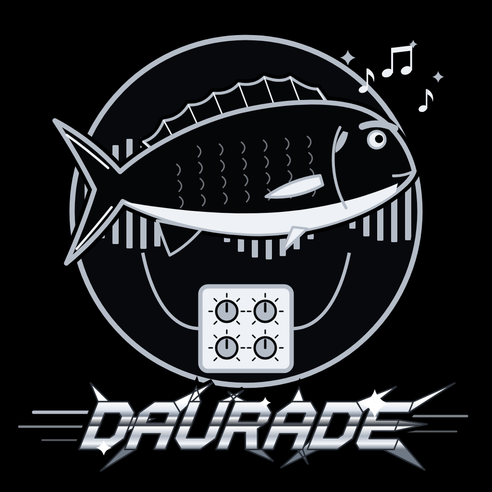
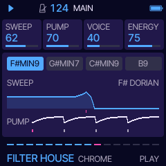
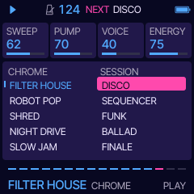
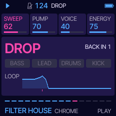
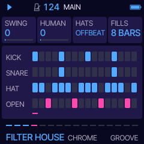

# Daurade

**Grooves in chrome for the M-VAVE FM-1: filtered, pumping, robotic.** Press PLAY and Daurade plays a groove: a
filtered loop that opens over sixteen bars, a mix that pumps on every kick, a robot voice singing the hook, and
very crisp drums. Ten styles on two sides, CHROME and SESSION. You steer it with four knobs, drop it, set off a
solo, play the lead yourself on the keys. Built on [Tuna](https://github.com/delirioux/tuna) and
[Felucca](docs/FELUCCA.md).

> **Version 0.1, a test build.** Not yet tried on an FM-1. Built with no warranty. Felucca's or Tuna's installer, or
> the official V15, takes the FM-1 back.

## Install

Open **[delirioux.github.io/daurade](https://delirioux.github.io/daurade/)** in Chrome or Edge on a computer, connect
the FM-1 with a USB data cable and press Install (allow MIDI when the browser asks). The page checks the package in
the browser and writes it over USB-MIDI, as Felucca's installer does. Daurade keeps its settings and its eight sets
in Felucca's first two song slots: back up anything you made in Felucca first.

Or **try it in the browser** first: [delirioux.github.io/daurade/try](https://delirioux.github.io/daurade/try/) runs
the same firmware, compiled to WebAssembly on Felucca's browser emulator (Chrome, Edge or Firefox; the computer
keyboard plays the keys).

Test builds: every push to `dev` leaves a package in the GitHub run's artifact `daurade-firmware`; the installer's
"Install a test build" takes it. From a terminal: `python3 tools/fm1_install.py daurade-X.Y.fwsc`.

## The four knobs

| | |
| --- | --- |
| **SWEEP** | The low-pass on the loop. The knob is its ceiling; over each sixteen-bar cycle the filter breathes up to it and falls back (the footer's sixteen dashes are the cycle). A build opens it all the way, a drop closes it. |
| **PUMP** | How deep the whole mix ducks on each kick and breathes back. The drums never duck. |
| **VOICE** | How much of the robot voice: off, the hook in every second half of eight bars, or singing all the way. |
| **ENERGY** | Density and drive together: from a bare groove to ghost notes, sixteenth hats and extra chops. |

## Ten styles

| CHROME: filtered, pumping, robotic | | SESSION: played, warm, humanized | |
| --- | --- | --- | --- |
| **FILTER HOUSE** · 124 | stab loop, long sweep, heavy pump | **DISCO** · 116 | walking octave bass, muted plucks, string swells |
| **ROBOT POP** · 112 | the robot sings the melody over EP chords | **SEQUENCER** · 112 | sixteenth-note bass, its filter opening over the song |
| **SHRED** · 123 | a distorted guitar-like solo, fast runs | **FUNK** · 108 | clavinet, slap bass, tight hats |
| **NIGHT DRIVE** · 105 | minor key, dark pads, a pulsing arpeggiator | **BALLAD** · 88 | EP and strings, sparse drums |
| **SLOW JAM** · 98 | mellow EP, long filtered pad, a soft robot | **FINALE** · 120 | string runs, brass hits, crescendo |

A style brings its own tempo, sounds, key, chord loop, groove, drums and space; your MIX, ARC, SOLO and MENU
stay. A new style or song comes in on the next bar line, so a groove never changes mid-bar. ALGORITHM picks
another song in the same style: a new chord loop, bass line and hook, the same each time you come back to its number.

With **ARC** on (the default) a song shapes itself: an intro that brings the parts in one by one, the main groove, a
build with a snare roll and the filter opening, a drop, a solo, a breakdown, and round again with a new hook.

## The controls

| | |
| --- | --- |
| SELECT | tempo |
| MASTER | volume |
| PRESETS | the style (the list shows while turning; it comes in on the next bar) |
| ALGORITHM | a new song in the same style (on the next bar) |
| KNOB 1-4 | the four cards on the screen (PLAY: SWEEP PUMP VOICE ENERGY) |
| PLAY | start (with the intro) / stop |
| REC | DROP: tapped, everything but the filtered loop drops out for two bars and slams back on the bar line; held, it stays dropped until you let go |
| SEQ | SOLO: a solo from the next beat, over SOLO's bars; again, it stops. Shows the SOLO page |
| keys | the lead, live, snapped to the scale: whatever you press is in key. The keys only ever play music |
| OCT- / OCT+ | the keys' octave |
| HOME | PLAY; hold it: MENU (COLOR, LOOK) |
| FX | SOUND (the four parts' sounds), again: TONE (RESO DRIVE PHASER CRUSH) |
| LFO | VOICE (VOWELS SHIFT TALK GLIDE) |
| SCL | KEY (KEY SCALE CHORDS BARS) |
| ARP | GROOVE (SWING HUMAN HATS FILLS) |
| EDIT | DRUMS (KIT KICK SNARE SNAP) |
| GLO | MIX (the four levels), again: SPACE (REVERB DELAY TIME WIDTH) |
| ENV | ARC (ARC BUILD DROP SOLO) |
| SAVE | SETS: eight sets on the knobs (SET, LOAD and STORE turned right, CLEAR turned right three times) |

The keys' LEDs glow on the notes of the chord playing: the ones that fit right now. MIDI out: STABS on channel 1,
BASS on 2, LEAD on 3, the drums on 10 (General MIDI notes). The settings and the sets save themselves while stopped.
[docs/MANUAL.md](docs/MANUAL.md) goes through every page.

## The sound

Four parts on Felucca's engines, ten sounds each (STABS: CHROME, EP, REED EP, STRINGS, BRASS, CLAV, GUITAR, ORGAN,
RAVE, PAD; BASS: FM BASS, SQUARE, ACID, SUB, SLAP, FRETLESS, FAT, WOW, DISCO, UPRIGHT; LEAD: ROBOT, TALKBOX, SAW,
SYNC, GUITAR, STRINGS, BRASS, CHIP, SINE, ORGAN), evened out so a new sound does not jump out of the mix. The robot
is Felucca's VOICE engine, a formant synthesizer, at full buzz and a high Q: it talks through two vowels on every
note, in time with the tempo.

The drums are Daurade's own: seven one-shots (two kicks, snare, clap, closed and open hat, crash) synthesized by
[`tools/da_drums.py`](tools/da_drums.py), every hit at full level on its first sample, stored at 44.1 kHz so the hats
keep their air. They are dedicated to the public domain (CC0). The KIT card: CRISP (these), SESSION or MACHINE (Felucca's DRUM
engine).

Colours: NEBULA, Daurade's own (deep indigo, electric blue, hot magenta), and all of Felucca's.

## Building

As Tuna and Flyfish (see [BUILDING.md](BUILDING.md)), with `FELUCCA_DAURADE=1 ./build.sh`. GitHub Actions builds
every push to `main` and `dev`; a push to `main` also publishes the site with the installer (`web/da_make_site.py`;
the repository needs Settings > Pages > Source: GitHub Actions). `sh tests/da_tests.sh` runs the host tests;
`sh tests/da_felucca.sh OUTDIR` renders a groove through Felucca's engines to a WAV; `sh tests/da_audition.sh`
measures every sound's loudness; `web/emu/da_build.sh` builds the browser version (Emscripten, or clang with a WASI
sysroot). Design notes and the plan: [docs/DEVELOPMENT.md](docs/DEVELOPMENT.md).

## Credits and licence

GPL-3.0-only. Daurade by delirioux, written with Claude; a fork of Flyfish and Tuna (delirioux), forks of Felucca by
Leo Kuroshita, Hügelton Instruments; the web installer is Felucca's. The drum samples are CC0. See
[CREDITS.md](CREDITS.md) and [LICENSING.md](LICENSING.md).
