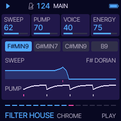
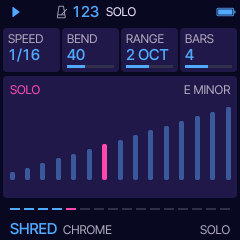

# Daurade manual

Daurade 0.1. Every page, every card. Four parts play: **STABS** (the chord loop), **BASS**, **LEAD** (the hook, the
robot, the solo, and whatever you play on the keys) and **DRUMS**. Knob 1 to 4 turn the four cards on the screen.
A page's button pressed again goes to its second page where it has one.

## Playing

PLAY starts with the intro (with ARC on) and stops. PRESETS opens the list of the ten styles while you turn; the
chosen one comes in on the next bar line, NEXT on the footer until it does. ALGORITHM picks a new song in the same
style on the next bar: its number seeds the chord loop, the bass line and the hook, so a song always comes back the
same. SELECT is the tempo, MASTER the volume.

**REC is DROP.** Tap it: everything but the filtered loop drops out for two bars and slams back on the bar line.
Hold it: it stays dropped until you let go, and comes back on the next bar line.

**SEQ is SOLO.** The LEAD plays a solo from the next beat, on the style's solo sound, for SOLO's BARS; SEQ again
stops it. The SOLO page shows meanwhile.

**The keys** play the LEAD, live, snapped to the scale: any key you press is in key. While you hold one, the hook
makes way. OCT- and OCT+ move the keys' octave. The keys' LEDs glow on the notes of the chord playing. The keys
never change a setting.

## The pages

| Page (button) | Cards |
| --- | --- |
| **PLAY** (HOME) | **SWEEP** the filter's ceiling; over every sixteen bars it breathes from just under half of it up to all of it, and falls back over the last two (the footer's sixteen dashes). **PUMP** how deep the mix ducks on each kick. **VOICE** how much of the robot: off, the hook in the second half of every eight bars, or all the way. **ENERGY** density and drive: ghost notes, sixteenth hats, extra chops. |
| **SOUND** (FX) | **STABS**, **BASS**, **LEAD**: ten sounds each. **DRUMS**: the kit, CRISP (Daurade's own one-shots), SESSION or MACHINE (Felucca's DRUM engine). |
| **TONE** (FX again) | **RESO** the swept filter's resonance. **DRIVE** saturation. **PHASER**. **CRUSH** bits and rate, down from clean. |
| **VOICE** (LFO) | The robot. **VOWELS** the two vowels it talks between (AH-EE, OH-AH, OO-EE, EE-AH, AH-OH). **SHIFT** its formants, -12 to +12. **TALK** how fast it talks (1/16 to 1/2). **GLIDE** between notes. |
| **KEY** (SCL) | **KEY** the root. **SCALE** DORIAN, MINOR, MAJOR, MIXOLYDIAN, LYDIAN, HARMONIC MINOR. **CHORDS** one of twelve chord loops. **BARS** a chord lasts 1, 2 or 4 bars. |
| **GROOVE** (ARP) | **SWING** on the sixteenths. **HUMAN** timing and velocity, as a player would. **HATS** 8THS, 16THS, OFFBEAT or OPEN. **FILLS** every 8, 4 or 2 bars, or none. |
| **DRUMS** (EDIT) | **KIT** as on SOUND. **KICK** PUNCH or ROUND. **SNARE** CLAP, SNARE or BOTH. **SNAP** the transients: from round to very crisp. |
| **MIX** (GLO) | the four parts' levels. |
| **SPACE** (GLO again) | **REVERB**, **DELAY**, **TIME** the delay in 1/16, 1/8, 3/16 or 1/4, **WIDTH** the stereo spread. |
| **ARC** (ENV) | **ARC** on: the song shapes itself, intro, main, build, drop, solo, breakdown and round again with a new hook; off: the main groove on and on. **BUILD** 4, 8 or 16 bars. **DROP** AUTO: the arc drops after a build. **SOLO** AUTO: the arc plays a solo. |
| **SOLO** (SEQ) | **SPEED** 1/8, triplets or 1/16. **BEND** how much it bends into notes. **RANGE** 1, 2 or 3 octaves. **BARS** 2, 4 or 8. |
| **SETS** (SAVE) | Eight sets: the whole groove, style and all. **SET** picks one, **LOAD** and **STORE** turned right do it, **CLEAR** turned right three times empties it. |
| **MENU** (hold HOME) | **COLOR** the palette: NEBULA by default, and Felucca's. **LOOK** FLAT or LINE. |

A style sets its tempo, sounds, key, chord loop, groove, drums and space. MIX, ARC, SOLO and MENU stay yours.

## MIDI out

STABS on channel 1, BASS on 2, LEAD (and the keys) on 3, the drums on 10 with General MIDI notes.

## Saving

The settings save themselves two seconds after the last change while stopped, never while playing (writing the
flash would stall the audio). They live in Felucca's first song slot, the sets in its second.
